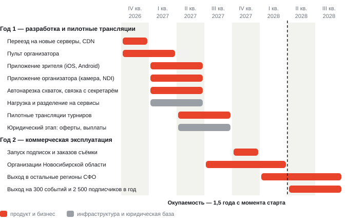

Бизнес-план · октябрь 2026

# «Лига» — медиаплатформа спортивных трансляций

Запрос инвестиций: 5 000 000 ₽. Платформа уже работает, турниры идут. Инвестиции нужны на мобильные приложения, инфраструктуру под нагрузку и запуск платных сервисов в Сибирском федеральном округе.

<b>5 000 000 ₽</b>запрос инвестиций

<b>17,55 млн ₽</b>выручка второго года при 3 % рынка

<b>10,55 млн ₽</b>чистая прибыль второго года

<b>1,5 года</b>полная окупаемость с момента старта

## 1. Что уже есть

Платформа liga-live.ru работает в продакшне. Организация, проводящая турнир, подключает свой видеомикшер и отправляет видео на платформу. Зритель открывает страницу трансляции в браузере, без регистрации, и сам переключает камеры между коврами. После турнира запись доступна в архиве, её можно пересмотреть и скачать.

- Приём видео по SRT и RTMP от любого микшера (vMix, OBS).
- Переключение камер на стороне зрителя: сервер получает один поток со всеми коврами, плеер вырезает нужную четверть кадра на устройстве.
- Чат, архив записей, скачивание MP4, закрытые трансляции по ссылке.
- Кабинет организации со статистикой эфира, рекламные места на страницах, автоматическая выкладка обновлений без остановки эфира.

Главное техническое решение: сервер не пересобирает и не разрезает видео. Поэтому на трансляцию с четырёх ковров организации нужен один канал с арены, а платформе — инфраструктура на порядок дешевле, чем при отдельном эфире с режиссурой на каждый ковёр.

## 2. Какую задачу решаем

**Организаторы.** Региональные и детские турниры идут в VK Видео отдельным эфиром на каждый ковёр. На каждый эфир нужен свой канал и свой человек. На аренах редко есть интернет от 500 Мбит/с, и две одновременные трансляции лагают обе. Подрядчик за трансляцию с 1–3 камер берёт 30 000–70 000 ₽, продакшн-студия — от 45 000 ₽ за матч.

**Зрители.** Родители и тренеры следят за несколькими спортсменами, которые выходят на разные ковры. Приходится переключаться между эфирами и угадывать, где сейчас схватка. После турнира запись нужной схватки приходится искать в многочасовой записи ковра.

**Что даёт «Лига».** Организатору — одну трансляцию на весь турнир по одному каналу, без подрядчика. Зрителю — выбор камеры в одном плеере, уведомление о начале эфира, клип каждой схватки с фамилиями и счётом. Переключение между коврами и нехватку канала на арене подтвердила организация, которая уже перешла на платформу с VK, и опрос её зрителей; спрос на записи отдельных схваток подтверждён обратной связью зрителей на платформе.

## 3. Кто ещё на рынке

| Площадка | Как устроена трансляция | Чего нет |
|---|---|---|
| VK Видео | Отдельный эфир на каждый ковёр в сообществе федерации | Выбора камеры в одном плеере; понятий «турнир» и «ковёр»; эфир теряется в ленте |
| WrestlingTV.ru (ФСБР) | Отдельный поток на ковёр, страницу заводит менеджер по заявке за 5 дней, на каждый ковёр камера и линия от 50 Мбит/с | Самообслуживания; доступа для региональных и детских турниров; приложения |
| Facecast | Многокамерный плеер, 4 камеры только на корпоративном тарифе | Спортивного каталога; доступной цены: разовый эфир 990–13 990 ₽, месяц от 4 990 ₽ |
| Продакшн-студии | Выездная съёмка и режиссура | Цены для регионального турнира: от 45 000 ₽ за матч |

YouTube в России с февраля 2026 года фактически недоступен. Из российских площадок ни одна не даёт одновременно самообслуживание для организатора и выбор камеры для зрителя.

## 4. Рынок

Пилотный регион — Новосибирская область. По данным министерства спорта региона, на 2025–2026 годы запланировано более 1 100 спортивных мероприятий в год. В спортивных школах региона систематически занимаются около 29 000 детей и подростков по 76 видам спорта.

| Показатель | Новосибирская область | Сибирский федеральный округ, 10 регионов |
|---|---|---|
| Спортивных мероприятий в год | более 1 100 | более 10 000 |
| Активных спортсменов в спортшколах | около 29 000 | более 250 000 |
| Потенциальных плательщиков | не менее двух родителей на каждого спортсмена | более 500 000 |

Оценка по округу получена экстраполяцией данных пилотного региона на 10 регионов СФО и взята как консервативная.

## 5. Цель первого коммерческого года: 3 % рынка

| Показатель | База | Цель, 3 % |
|---|---|---|
| Турниры с трансляцией и нарезкой | 10 000 событий в год по СФО | 300 событий в год |
| Активные зрители — хотя бы раз воспользовались платформой | 250 000 спортсменов и их родители | 7 500 зрителей |
| Платящие подписчики — подписка или заказ персональной съёмки | 7 500 активных зрителей | 2 500 подписчиков |

## 6. Откуда деньги

| Источник | Расчёт | В год |
|---|---|---|
| Подписки зрителей | 500 ₽/мес. за архив и HD-качество; 2 500 подписчиков × 500 ₽ × 12 мес. | 15 000 000 ₽ |
| Комиссия с заказов съёмки | 20 % с заказа при среднем чеке 300 ₽ — 60 ₽ с заказа; 15 000 заказов в год | 900 000 ₽ |
| Спонсорские пакеты | Реклама на турнире, пакеты от 5 000 до 50 000 ₽; 300 событий × 5 000 ₽ | 1 500 000 ₽ |
| Продажа эксклюзивов | Выкуп и перепродажа уникальных кадров, около 10 % от числа заказов | 150 000 ₽ |
| **Итого при 3 % рынка** | | **17 550 000 ₽** |

Просмотр трансляций остаётся бесплатным. Подписка открывает архив и HD-качество; это не сокращает аудиторию, ради которой организации приходят на платформу.

## 7. Что строим на инвестиции

- **Веб-платформа** — уже работает. Переезжает на новые серверы, получает пульт организатора: создать турнир, выдать ключи, видеть источники, запустить и остановить эфир с одного экрана. Организации получают статистику по своим зрителям, в первую очередь по регионам.
- **Приложение зрителя** (iOS, Android) — каталог турниров, поиск по фамилии спортсмена и названию турнира, плеер с выбором камеры, лента клипов схваток, чат, подписки на организации и уведомление о начале эфира.
- **Приложение организатора** (iOS, Android) — видеомикшер в телефоне со встроенными функциями платформы. Стрим напрямую с камеры телефона; сбор по NDI потоков с других камер в той же сети и отправка на платформу одним собранным потоком или несколькими отдельными. Снимает необходимость в ноутбуке с vMix на площадке.
- **Автоматическая нарезка схваток.** По таймкодам из приложения секретаря турнира сервер вырезает каждую схватку из записи, накладывает фамилии и счёт и публикует клип в ленту. Приложение секретаря у организации уже есть, платформа забирает из него данные.
- **Платные сервисы** — подписки и заказы съёмки с приёмом оплаты через ЮKassa. Выходят отдельным этапом после юридической подготовки оферт.
- **Инфраструктура под нагрузку** — вынос раздачи видео на CDN и несколько серверов. Цель — 2 000 одновременных зрителей на одну трансляцию, подтверждённые нагрузочным тестом. Сейчас один сервер держит около 250.

## 8. План работ

**Год 1 — разработка и пилотные трансляции.** До конца 2026 года платформа переезжает на новые серверы с CDN, появляется прототип пульта организатора и прототипы приложений. С января по май 2027 года приложения доводятся до рабочих версий, запускается автонарезка схваток. Параллельно команда выносит раздачу видео из приложения на CDN и разделяет систему на сервисы, чтобы части продукта выкатывались независимо. Весной и летом 2027 года — пилотные трансляции турниров и юридическая подготовка подписок и выплат.

**Год 2 — коммерческая эксплуатация.** Запуск подписок и заказов съёмки, подключение организаций Новосибирской области, затем остальных регионов округа. Выход на 300 событий и 2 500 подписчиков в год к концу второго года.

## 9. Куда идут 5 000 000 ₽

| Статья | Сумма |
|---|---|
| Разработка ПО: приложение зрителя, приложение организатора, серверная часть | 2 500 000 ₽ |
| Серверы и CDN на первый год | 600 000 ₽ |
| Маркетинг и запуск: подключение организаций, реклама | 1 000 000 ₽ |
| Юридические услуги: оферты, защита контента | 400 000 ₽ |
| Резервный фонд | 500 000 ₽ |
| **Итого** | **5 000 000 ₽** |

## 10. Финансовый результат

| | Год 1 — разработка и пилоты | Год 2 — коммерческая эксплуатация |
|---|---|---|
| Выручка | около 400 000 ₽ | около 17 550 000 ₽ |
| Операционные расходы: серверы, поддержка, налоги, маркетинг | из бюджета инвестиций | около 7 000 000 ₽ |
| Чистая прибыль | — | около 10 550 000 ₽ |

Инвестиции в 5 000 000 ₽ возвращаются из прибыли второго года. Срок полной окупаемости — 1,5 года с момента старта. Расчёт сделан для 3 % рынка; при 5 % выручка и прибыль растут пропорционально.

## 11. Риски

| Риск | Что делаем |
|---|---|
| Доля платящих зрителей окажется ниже заложенной: один из трёх активных | Проверяем на пилотных трансляциях до основных затрат на маркетинг; при низкой конверсии выручка держится на подписках организаций и спонсорских пакетах |
| Оферты, права на контент, выплаты за съёмку | Юридический этап заложен до запуска платных сервисов, на него выделено 400 000 ₽ |
| Интернет на аренах | Платформе нужен один канал на всю трансляцию, а не на каждый ковёр; приложение организатора работает с камеры телефона по мобильной сети |
| Площадки с большой аудиторией добавят выбор камеры | Наше преимущество — самообслуживание, спортивный каталог и цена для регионального турнира; у площадок с миллионами роликов нет понятий «турнир» и «ковёр» |

## 12. Команда

| Участник | Роль |
|---|---|
| [Имя, организация] | Инициатор проекта. Руководитель организации, проводящей турниры по спортивной борьбе и транслирующей их на платформе |
| Смолин Даниил | Тимлид, DevOps, автор текущей платформы Liga Live |
| Сидоренко Софья | Системный аналитик |
| Бабич Руслана | Android-разработчик |
| Краснянский Пётр | iOS-разработчик, DevOps |
| Соловьёв Матвей | [Роль] |

Контакты: [имя], [телефон], [почта]. Платформа: liga-live.ru.

