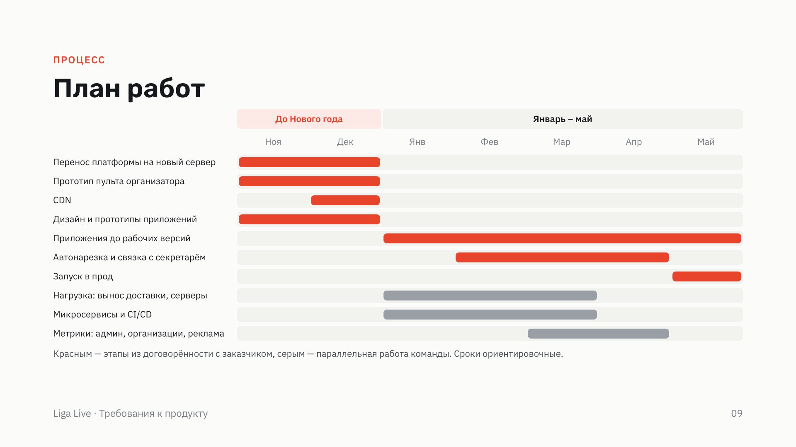
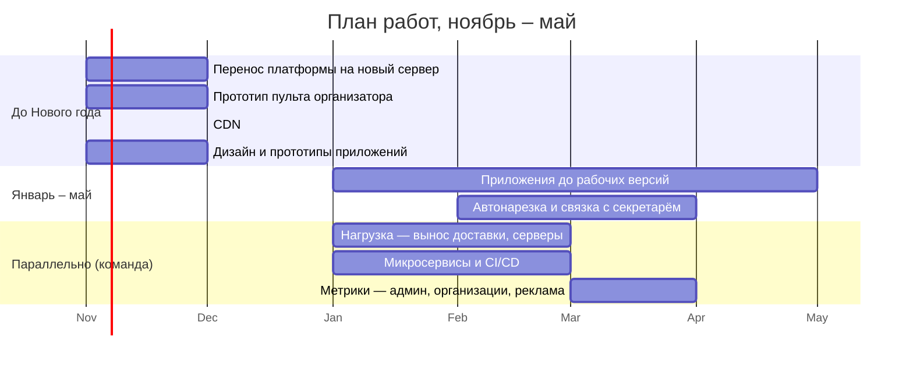

# Требования к продукту — сопроводительный документ к выступлению (7 минут)

Рабочий документ команды для выступления «требования к разрабатываемому
программному продукту и почему они именно такие». Источник истины по
продукту и архитектуре — [`vision.md`](vision.md); здесь — выжимка под
речь, структура слайдов и план работ.

Рядом лежат:

- [`requirements-talk-slides.pdf`](requirements-talk-slides.pdf) — презентация, 9 слайдов;
- [`requirements-plan-gantt.png`](requirements-plan-gantt.png) — план работ диаграммой Ганта (тот же, что на последнем слайде).
- [`srs.md`](srs.md) — полная спецификация требований с номерами и статусом.

---

## 0. Рамки: о чём говорим и с каким фокусом

| Тема | Фокус |
|---|---|
| Нагрузка, разделение на сервисы и CI/CD, метрики | **Основной.** Ядро работы команды на предмете |
| Функции организатора: событие, пульт, автонарезка, связка с приложением секретаря | **Основной.** Создают сценарии и нагрузку, под которые строится остальное |
| Приложение зрителя (iOS/Android) | Упоминаем: параллельная команда того же состава; с нашей стороны — контракт API, клипы, push |
| Приложение организатора (по образцу Mevo: NDI-камеры, пульт, плагины) | Упоминаем: параллельная задача; с нашей стороны — ингест нескольких потоков и API пульта |
| Платные подписки зрителя через ЮKassa | Упоминаем как возможный отдельный этап, вне плана работ |
| Сроки | Ориентировочные, по этапам из договорённости с заказчиком; уточняются по согласованным юз-кейсам |

Заказчик требования пока не утверждал, поэтому у спорных решений на слайдах
стоит пометка «если изменится» с запасным вариантом. Вслух это звучит одной
фразой, отдельного слайда про это нет.

---

## 1. Контекст в двух абзацах

**Что есть.** Liga Live (liga-live.ru) — работающая платформа трансляций
спортивных турниров. Организация подключает свой видеомикшер по SRT или
RTMP. Зритель смотрит в браузере без регистрации, сам переключает камеру,
пишет в чат, пересматривает и скачивает запись. Есть кабинет организации,
приватные эфиры по ссылке, архив в S3, админка, экран ёмкости, CI/CD с
автодеплоем под живым эфиром. Всё работает в продакшне на одном сервере.

**Ключевое решение, на котором стоит продукт:** сервер никогда не
пересобирает и не разрезает входящее видео, компоновка — у зрителя.
Организация может прислать один композитный поток (мозаика 2×2 из vMix) и
зритель вырежет нужную четверть на устройстве, а может прислать четыре
потока и больше — по одному на ковёр — и зритель смотрит любой отдельно или
все вместе в раскладке на одном экране. Организации это даёт канал под
трансляцию вместо отдельной трансляции с режиссурой на каждый ковёр,
платформе — инфраструктуру на порядок дешевле, чем у конкурентов.

---

## 2. Откуда берутся требования (для себя, не для слайдов)

1. **Заказчик** — руководитель организации, проводящей турниры по борьбе и
   транслирующей их на платформе: пульт, автонарезка схваток, связка с его
   приложением секретаря, мобильный клиент для зрителей, приложение-пульт с
   NDI-камерами, рост аудитории.
2. **Зрители** — родители, тренеры, болельщики (гипотезы H1–H3 из отчёта по
   заданию 1): неудобно переключаться между эфирами ковров, пропускают
   начало схватки, не находят запись конкретной схватки.
3. **Рынок** — VK Видео и WrestlingTV: отдельный эфир на каждый ковёр, нет
   самообслуживания; YouTube в РФ недоступен.
4. **Границы текущего решения** — раздел 2.6 `vision.md`: потолок по
   зрителям задан каналом одного сервера (~250, расчёт), API сам раздаёт
   видео, монолит, одна точка отказа, наблюдаемость только продуктовая.

---

## 3. Требования и почему они такие

### 3.1 Инварианты

| Требование | Почему |
|---|---|
| Сервер не пересобирает и не разрезает видео; компоновка на клиенте — кроп квадранта или раскладка нескольких потоков организации | Экономика продукта: один канал с арены, N зрителей = N декодирований тех же потоков, что пришли с площадки, никакого серверного транскода основного фида |
| Платформа не привязана к виду спорта | Стартовая ниша — борьба, но ни одна сущность системы не знает про ковры; рынок расширяется без переделки |

### 3.2 Требования от заказчика

| Требование | Зачем | Если изменится |
|---|---|---|
| **Событие (турнир)**: название, дата, число ковров; к нему привязаны эфиры, записи и клипы | Сейчас есть только поток и эфир; без события нет расписания, поиска по турниру и привязки схваток | Число ковров может стать числом потоков или раскладкой мозаики |
| **Пульт организатора**: создать событие, выдать ключи, статус источников, старт и стоп эфира | Один экран управления вместо набора страниц у ноутбука с микшером | Веб-кабинет первым; в приложении организатора — когда оно будет готово |
| **Автонарезка схваток**: по таймкодам сервер вырезает фрагмент готовой записи, накладывает данные, публикует клип | Главная боль зрителя H2: «не могу найти запись конкретной схватки»; клипы — лента в приложении зрителя. Режется запись, не эфир | Состав наложения (фамилии, счёт, флаги) и момент публикации уточняем |
| **Связка с приложением секретаря**: приложение у заказчика уже есть, забираем из него фамилии, счёт и таймкоды «начало» и «конец схватки» | Источник данных для нарезки и поиска по спортсмену; свой модуль ввода не пишем | Глубина интеграции — события в реальном времени или протокол после схватки — после изучения его API |

### 3.3 Клиенты платформы

| Клиент | Что | Если изменится |
|---|---|---|
| **Приложение зрителя** (параллельная команда) | Каталог, поиск по спортсмену и турниру, плеер с выбором камеры, вертикальная лента клипов, чат, подписки на организации с push «эфир начался». С нашей стороны — контракт API и клипы | Шаг 0 — PWA с Web Push, чтобы проверить спрос на уведомления до нативного приложения |
| **Приложение организатора** (параллельная задача, по образцу Mevo) | NDI-камеры в одной сети, сборка картинки на площадке, отправка потока на платформу; пульт эфира, встроенный секретарь, плагины к трансляции (апскейлинг и другие) | Набор плагинов не определён с заказчиком; пульт и секретарь живут и в веб-кабинете |
| **Подписки зрителя** (возможный этап) | Добровольная платная подписка, оплата через ЮKassa | Состав — с заказчиком; этап может не состояться |

Базовый вариант — все клиенты ходят в одно API. Если изменится: отдельный
слой API для мобильных, если контракт веба им не подойдёт.

### 3.4 Нагрузка

| Сейчас | Цель |
|---|---|
| ~250 зрителей на сервер — расчёт по каналу одного сервера, не измерение | 2 000 одновременных зрителей на эфир — итоговая цифра. Достигается CDN и несколькими серверами (2–5); напрямую проверяется только нагрузочным тестом |

Три шага, в этом порядке:

1. **Доставка видео не через API.** Сегменты пишутся в origin-хранилище,
   зрителям их раздаёт nginx; приватные эфиры — подписанный URL. API
   становится stateless, рестарт не ставит отдачу на паузу. *Вариант:*
   S3-совместимое хранилище или общий том.
2. **CDN перед origin.** Кэш выносится к зрителю, исходящий трафик — в сеть
   провайдера. *Вариант:* Yandex Cloud CDN, EdgeCenter или Selectel — по цене
   трафика и точкам в регионах зрителей.
3. **Несколько медиа-серверов.** Приём потоков и подготовка качеств выносятся
   на отдельные серверы, организации распределяются между ними; больше
   серверов — больше параллельных эфиров. *Вариант:* кодирование на
   видеокарте вместо процессора, если такие серверы выйдут дешевле.

### 3.5 Микросервисы и CI/CD

- **Зачем режем.** Сейчас один монолит: одна сборка, один деплой. Любая
  правка гонит весь CI, и это занимает много минут. Над платформой и над
  приложениями работают разные люди — они не должны мешать друг другу в CI и
  ждать чужую сборку.
- **Что меняем в CI/CD.** У каждого сервиса свой пайплайн и своя выкладка;
  CI/CD переписываем так, чтобы собиралось и выкатывалось только то, что
  изменилось. Переход на trunk-based development: короткие ветки, релиз из
  main, управляемо и без очереди на CI.
- **Как режем.** По одному сервису за раз, монолит продолжает работать.
  Первыми выходят части, которые меняются независимо: обработка записей,
  чат, приём потоков. Ядро с организациями, событиями и каталогом остаётся
  одним сервисом.
- *Если изменится:* границы сервисов уточняем по тому, какие команды над чем
  работают; связь между ними — очередь событий, Redis на старте или NATS при
  росте.

### 3.6 Наблюдаемость и инструменты

- **Метрики.** Суперадмину, который ведёт разработку: по потокам, зрителям,
  организациям и серверам. Организациям: по своим зрителям, в первую очередь
  из каких регионов их смотрят. Отдельно — метрики для рекламы. *Если
  изменится:* инструменты не зафиксированы, выбираем после согласования
  набора метрик (например, ClickHouse для аналитики, Prometheus и Grafana для
  серверов).
- **Ошибки.** Трекинг со стек-трейсами и привязкой к релизу: SDK в API, веб
  и приложениях, релиз равен SHA коммита, теги организации и эфира, алерты в
  Telegram. Сейчас ошибка обнаруживается по обращению зрителя. *Если
  изменится:* Sentry или более лёгкий GlitchTip.
- **Процесс разработки.** Нагрузочные тесты, чтобы цифры по зрителям были
  измерены, а не рассчитаны. Автотесты интерфейса и тестовый стенд на каждую
  ветку, чтобы проверять до выкладки. *Если изменится:* инструменты
  подбираем по ходу, вместе с переделкой CI/CD.

Нельзя масштабировать то, что не измерено: первый этап заменяет расчётный
потолок измеренным.

---

## 4. План работ

Красным — этапы из договорённости с заказчиком, серым — параллельная работа
команды. Сроки ориентировочные, уточняются по согласованным юз-кейсам.
Подписки зрителей — отдельным этапом вне плана. Отдельного «запуска в прод» нет: прод уже работает, функции внедряются в него постепенно.

---

## 5. Слайды и тайминг на 7 минут

| Мин. | Слайд | Что сказать |
|---|---|---|
| 0:00–0:20 | 1. Обложка | Liga Live — требования к продукту; команда |
| 0:20–1:20 | 2. Что есть сегодня | Работающая платформа с живыми турнирами; сервер не пересобирает видео, зритель сам выбирает камеру или раскладку из нескольких потоков |
| 1:20–1:50 | 3. Инварианты | Два пункта и почему они не обсуждаются |
| 1:50–3:00 | 4. Требования от заказчика | Событие, пульт, автонарезка, связка с приложением секретаря — и что в них может измениться |
| 3:00–3:45 | 5. Клиенты | Приложение зрителя (параллельная команда), приложение организатора с NDI и плагинами (параллельная задача), подписки как возможный этап; одно API как базовый вариант |
| 3:45–4:45 | 6. Нагрузка | ~250 сейчас → 2 000 как цель; доставка не через API → CDN → несколько медиа-серверов |
| 4:45–5:30 | 7. Микросервисы и CI/CD | Зачем режем (команды и CI), что меняем (пайплайн на сервис, trunk-based), как режем (по одному, ядро остаётся) |
| 5:30–6:15 | 8. Наблюдаемость | Кому какие метрики, трекинг ошибок, нагрузочные тесты и стенды; инструменты не фиксируем |
| 6:15–7:00 | 9. План работ | Гант: до Нового года и январь–май по договорённости с заказчиком; параллельно нагрузка, сервисы, метрики |
