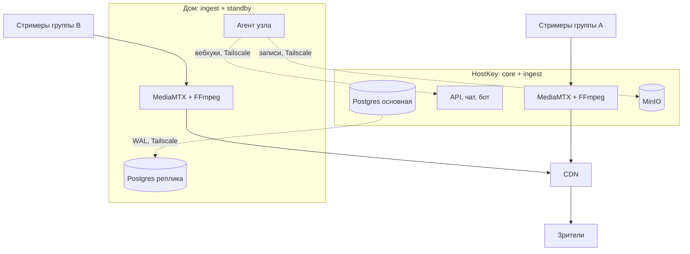

# RFC: Несколько узлов — распределение эфиров, выкатка без простоя, новые серверы

## Проблема
С 18.11.2026 прод работает на HostKey, домашний сервер — резерв. Второй сервер сейчас простаивает, а следующий подключить нечем, кроме ручной настройки. Нужно:
1. принимать больше эфиров одновременно за счёт всех серверов, а не держать резерв пустым;
2. при падении узла переносить его нагрузку на другие;
3. выкатываться без простоя;
4. подключать новый сервер одной командой и регулировать нагрузку флагами;
5. видеть все узлы на одном экране.

## Задачи
1. Решить, как делить нагрузку между узлами.
2. Описать выкатку без простоя.
3. Описать подключение нового узла.
4. Составить план работ с исполнителями и порядком относительно MVP (20 января).

## Текущее состояние (18.11.2026)
- **Прод — HostKey** (`liga-hk`): Ryzen 9 5950X, 16 ядер / 32 потока, 64 ГБ, 2 ТБ NVMe, 1 Гбит/с. На него указывают все пять имён (`liga-live.ru`, `www`, `admin`, `ads`, `bot`), TTL 300. Там же бот с Mongo, продление сертификата и еженедельный отчёт (`~/ops`).
- **Резерв — домашний сервер** (`pteradactyl`): 80 ядер, 256 ГБ, канал 750 Мбит/с. Postgres — потоковая реплика HostKey (слот `home_standby`, `max_slot_wal_keep_size = 5GB`). api, web, mediamtx и бот остановлены. Записи MinIO и Mongo бота — копия на 18.11, без синхронизации.
- **Связь**: оба сервера в одной сети Tailscale. Postgres HostKey открыт только внутри неё (`tailscale serve --tcp 5432`).
- **Выкатка**: CI на self-hosted раннере дома, `DEPLOY_HOST` — адрес HostKey в Tailscale. Если дом лежит, CI и релизы стоят.
- **Ловушка образа HostKey**: NetworkManager управлял всеми интерфейсами, и `nmcli networking off/on` снимал адреса с мостов Docker и `tailscale0` — сайт молча переставал отвечать при живых контейнерах. Исправлено файлом `/etc/NetworkManager/conf.d/zz-docker-unmanaged.conf`. Каждому новому серверу этого провайдера нужно то же.

## Нагрузка: во что упираемся
С CDN узел получает ~8 Мбит/с на эфир 1080p и отдаёт в CDN ~11 Мбит/с (RFC 002), так что канала хватает на десятки эфиров. Упирается процессор: ладдер 720p/480p/240p — 2–3 ядра на FullHD-эфир, ~7 на 4K.

| Узел | Ядер | FullHD-эфиров с ладдером (оценка) |
|---|---|---|
| HostKey | 16 (32 потока) | 5–7 |
| Дом | 80 | ~25 |

Вывод: делим не трафик процентами, а **эфиры по узлам**. Домашний сервер полезен прежде всего ядрами.

## Решение

### Принцип: узлы одинаковые, различие — роли и флаги
- **Как устроен сервер** описывает Ansible (роли), раскатывается одной командой.
- **Какой эфир на каком узле** — данные приложения: реестр узлов и планировщик в API. Решение принимается при назначении эфира, потому что стример заранее должен знать, куда слать поток. Kubernetes этого не решает: про эфиры он ничего не знает.

### Роли узлов
- `core` (сейчас HostKey): API — единственный, кто пишет в базу; чат, бот, основной Postgres, MinIO как общее хранилище записей, edge-nginx сайта.
- `ingest` (любой узел, включая core): MediaMTX + FFmpeg (приём и ладдер), агент узла (отдача HLS своих эфиров, обработка записей), nginx для HLS.
- `standby` (дом): реплика Postgres, повышается при отказе core.

### Хранилище записей
Внешний S3 пока не нужен. Код ходит в хранилище через `S3_ENDPOINT`, а MinIO на core — такой же S3: агенты заливают записи туда по Tailscale. Переход на внешний S3 (RFC 002) — смена переменной. До него MinIO — единственная копия архива, поэтому зеркало домой (`mc mirror`) обязательно.

### Распределение и флаги
Таблица `Node`: имя, адрес в Tailscale, адрес приёма (`ingest-<узел>.liga-live.ru`), роли, `acceptsNewStreams`, `drain`, вес, лимит ядер, версия, пульс. У стрима — `Stream.nodeId`.
- **Назначение** — при создании стрима или перед эфиром: узел с наибольшим свободным запасом с учётом веса. Ручное закрепление важнее автомата.
- **`drain`**: узел больше не получает эфиры, текущие доживают.
- **Перебалансировка** — только между эфирами. Идущий SRT/RTMP-поток не переносится: у SRT нет перенаправления.
- **Адрес приёма** стример видит в дашборде. Перенос стрима на другой узел — стример меняет адрес. После переезда DNS к провайдеру с API можно дать каждому стриму своё имя, и перенос станет незаметным.

### Отказ узла
- **Упал ingest-узел**: его эфиры переназначаются, имя `ingest-<узел>` переводится на соседа (нужен DNS с API, TTL 60), стримеры переподключаются.
- **Упал core**: повысить реплику (`select pg_promote()`), поднять API, web и бота на резерве, перевести A-записи. Секреты в `.env` на обоих серверах совпадают (проверено). Пока DNS у рег.ру — вручную, 5–10 минут.
- Пока core лежит, ingest-узлы не принимают новые эфиры: авторизация публикации идёт через API. Агенту стоит кэшировать её решения.

## Выкатка без простоя

| Часть | Как обновлять | Сейчас |
|---|---|---|
| web | два экземпляра за nginx: поднять новый → дождаться готовности → `nginx reload` → погасить старый | один экземпляр, состояния нет — готов |
| API | так же, по очереди — после доработок ниже | перезапуск, пауза HLS ~5 с |
| Отдача HLS | вынести из API в nginx: файлы с диска + `auth_request` к API с кэшем. Перезапуск API перестаёт задевать видео | отдаёт API |
| Приём | по узлам через `drain`: дождаться конца эфиров → обновить → вернуть в работу | `deploy.sh` не трогает MediaMTX под эфиром |
| Postgres | плановое переключение на реплику, запись встаёт на секунды | — |
| Бот | перезапуск за пару секунд, Telegram держит очередь. Два экземпляра нельзя | — |

### Что мешает двум API одновременно
1. При старте API переводит все записи из `processing` в `failed` — новый экземпляр убьёт конвертации старого. Нужен владелец записи и пульс.
2. Кроны (`retryFailed`, `finalizeStaleGlue`, перенос старых архивов) пойдут дважды. Нужен лидер через `pg_advisory_lock`.
3. Мьютекс вебхуков по стриму живёт в памяти — заменить блокировкой в базе.
4. Комнаты чата и счётчик зрителей в памяти — общий адаптер Socket.io (Redis или Postgres) и привязка WebSocket к экземпляру в nginx.
5. Сброс `LiveAccessCache` при закрытии стрима должен доходить до всех экземпляров — `LISTEN/NOTIFY`.
6. Миграции — отдельным шагом перед выкаткой и в два хода (расширить схему → убрать старое), а не при старте каждого API.
7. Корректная остановка: на SIGTERM — «не готов», дождаться запросов, закрыть сокеты с переподключением клиентов. Отдельные проверки «жив» и «готов».

### Выкатка по узлам
- По инвентарю, по одному узлу (`serial: 1`), первым — канареечный узел с малым весом.
- core выкатывается раньше агентов и понимает агентов предыдущей версии. Протокол агент ↔ core версионирован, планировщик не назначает эфиры на узел несовместимой версии.
- MediaMTX на узле обновляется только через `drain`.
- Проверка после выкатки идёт на тот узел, куда выкатываем. Сейчас `deploy.sh` проверяет адрес из DNS, то есть всегда текущий прод.

## Как добавить узел
1. Добавить сервер в инвентарь Ansible с ролью `ingest`.
2. `ansible-playbook site.yml --limit <узел>`: Docker, Tailscale (ключ без срока действия), исправление NetworkManager, sudo, файрвол, агенты мониторинга, стек агента, секреты.
3. Агент регистрируется в core, узел появляется в админке с `acceptsNewStreams = false`.
4. В админке выставить вес и лимит, включить приём. DNS-имя `ingest-<узел>` создаёт скрипт (после переезда DNS).

## Один экран
Стек из RFC 001 (Prometheus, Node Exporter, cAdvisor, Grafana, ClickHouse для логов) ставится на все узлы ролью Ansible и собирает данные по Tailscale. На дашборде — процессор и канал по узлам, эфиры на узле, отставание реплики и WAL, удержанный слотом. Контейнеры всех серверов можно смотреть через Portainer с агентами. Распределение эфиров по узлам — данные приложения, его показывает `/admin/capacity` с разбивкой по узлам.

## План работ

| Этап | Что | Кто | Объём |
|---|---|---|---|
| 0. Фундамент | Ansible: инвентарь, роли `base`, `docker`, `tailscale`, `monitoring`, `stack`; текущие два сервера описаны кодом. Мониторинг по RFC 001 на оба. Зеркало MinIO и дамп Mongo бота домой, копия сертификата после продления. Сценарий отказа core и одни учения. Второй раннер CI на HostKey с меткой `prod` | девопс | 1–1,5 нед. |
| 1. API без простоя | Отдача HLS в nginx; доработки 1–7 | разработка | 1,5–2 нед. |
| 2. Реестр узлов | `Node`, `Stream.nodeId`, MediaMTX по узлам, вебхуки с указанием узла, адрес приёма в дашборде | разработка | 1 нед. |
| 3. Агент узла | Образ API в режиме `NODE_MODE=agent`: без миграций, кронов и записи в базу. Отдаёт HLS своих эфиров с проверкой доступа (включая `previewKey`), заливает записи в MinIO core, шлёт пульс и нагрузку. `hlsUrl` ведёт на свой узел | разработка | 1–1,5 нед. |
| 4. Планировщик и флаги | Назначение по весу и запасу, ручное закрепление, `drain`, экран узлов в админке | разработка | 3–4 дня |
| 5. DNS и отказ | Зона у провайдера с API, `ingest-<узел>` с TTL 60, сторож: переназначение эфиров и перевод имени | девопс + разработка | 1 нед. |
| 6. CDN | Источник на каждый узел; три правки в коде: `hlsUrl` на CDN, заголовки кэша, CDN вне лимитов nginx | девопс + разработка | 3–4 дня |
| 7. k3s (по необходимости) | При 3–4 узлах и больше: агент как DaemonSet по метке `ingest`, core — на узле с меткой `core` | девопс | потом |

**Относительно MVP (20 января)**: до него — этап 0 и вынос отдачи HLS в nginx (часть этапа 1, несколько дней — заодно убирает паузу при каждой выкатке). Остальное — когда понадобится больше одновременных эфиров, чем тянет HostKey (5–7 FullHD).

## Не берём сейчас
- **Kubernetes.** Распределение эфиров — логика приложения, кубер её не даёт. На двух узлах нет кворума etcd. Ansible поставит k3s позже, реестр узлов и агент при этом не меняются.
- **Внешний S3.** Хватает MinIO на core с зеркалом. Переход — смена `S3_ENDPOINT`.
- **Деление трафика процентами.** HLS эфира лежит на диске одного узла.
- **Автоматическое переключение core** — до переезда DNS к провайдеру с API.

## Риски
- Домашний узел — это домашний интернет: смена IP, питание, условия провайдера. Для транскода хорош, как единственный резерв core рискован.
- База одна: узлы масштабируют приём и транскод, но не запись в базу. Для нашего масштаба нормально.
- Секреты на N узлах раскладываются только из одного места (Ansible Vault), иначе расходятся.
- Метрики ёмкости (`capacity/`) считаются по логу nginx одного узла — нужно собирать со всех.
- До внешнего S3 MinIO на core — единственная копия архива, кроме зеркала.

## Открытые вопросы
- Умеет ли Timeweb CDN несколько источников в одном ресурсе, или нужен ресурс на каждый узел?
- Какой DNS-провайдер с API берём (RFC 002 предлагает Yandex Cloud DNS)?
- Переподключается ли vMix сам после смены адреса (открыт с RFC 002)?
- Нужен ли третий маленький узел для кворума — только если k3s будет одним кластером на все узлы.
